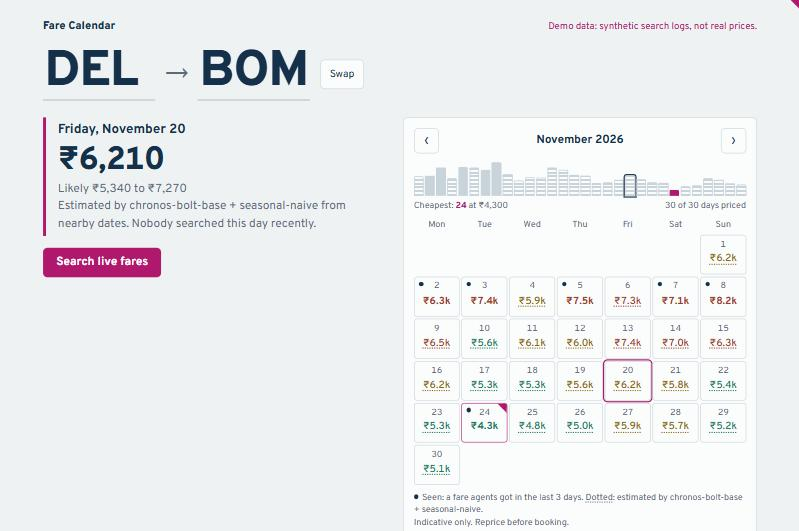

# Fare Calendar

A date picker for B2B flight booking that shows the **estimated lowest fare under every date** *before* the agent runs a live search. It's built from the booking platform's own server logs and runs on two open-weight models, with no fare data leaving the agency:

- **Gemma 4** (local, via Ollama) reads each supplier's response format and writes the mapping that pulls fares out of it.
- **Chronos-Bolt** (CPU), averaged with a weekday baseline, estimates the lowest fare for dates nobody has searched recently.



## Why

Agents burn live supplier searches (and GDS look-to-book quota) testing dates one at a time while a customer waits. A fare calendar answers "which day is cheapest?" at a glance. Building it from your own logs means it reflects the fares *your* suppliers actually return to *your* agents.

## How it works

```
server logs ──► Gemma-written supplier mappings ──► fare observations (route, date, lowest adult fare, when seen)
 (13 suppliers,     validated by code on real                     │
  JSON + XML)       responses before use                          ▼
                                             lead-time model: "fare at 22-30 days out" per departure date
                                                                  │
                                         Chronos-Bolt fills every unsearched stretch of the calendar
                                         from the departure dates before it (gaps left as gaps)
                                                                  │
                         seen in last 3 days? ── yes ──► show the real fare ("● seen")
                                  │ no
                                  ▼
                 re-price for today's lead time, blend in older searches ──► "est." with a likely range
                                                                  │
                                       forecasts.json ──► light API (no torch) ──► <fare-calendar> widget
```

1. **Ingest** (`farecal/ingest/`). Each search in `logs/searches/*.jsonl` is joined to its per-supplier response folder. A small mapping language (`spec.py`) works the same over JSON and XML: one spec per supplier says where the rows, fare, date, route and currency are. Only route, dates, fare and timestamp are kept. No org/user ids, passenger data or bookings are read.
2. **Gemma writes the mappings** (`gemma.py`, `scripts/map_supplier.py`). Gemma 4 sees a shrunken sample of one response and proposes a spec. Code then applies it to several real responses and rejects it unless:
   - most responses produce rows
   - fares are plausible totals
   - the searched route actually appears
   - nothing except currency is a hard-coded constant

   Failures go back to Gemma as feedback. Gemma never touches fares at run time.
3. **Lead time** (`leadtime.py`). Fares climb as departure nears. A two-way fixed-effects fit in log space separates "which day you fly" from "how far ahead you searched".
4. **Forecast** (`engine.py`, `forecast.py`). For each route, every unobserved stretch from today on is forecast by Chronos-Bolt from all departure dates before it. Missing days are passed as NaN, which Chronos masks natively, so nothing is invented. Routes need ≥10 observed dates before they get estimates.
5. **Serve** (`api.py`, `view.py`). `build_artifact.py` writes `forecasts.json` where the data lives. The API serves it with FastAPI and the standard library only, behind Basic auth or an API key.

## Results on real logs

The data is one month of production logs (Sep 15 – Oct 16, 2026): 2,327 searches by 16 agents across 13 suppliers, plus a 150-search scan through the test environment. Only one-way economy searches for a single adult are used (85% of traffic), so every supplier's figure is a per-adult fare.

### Supplier mappings

All 11 mappings passed the same validator on 6 of 6 real responses.

| | Suppliers | How |
|---|---|---|
| **Written by Gemma 4** | Kandhari, AirIQ, CheapFixDeparture, AIX, BatikAir, Scoot, Emirates | Local `gemma4` (7.5B, Q4) on a 4 GB laptop GPU, 1–6 attempts each with validator feedback |
| Hand-written | Amadeus | Public GDS format, used as Gemma's worked example |
| Hand-written after Gemma didn't converge (11 attempts each) | IndiGo, SpiceJet, StarAir | IndiGo and SpiceJet split each fare into charges, with discounts stored as positive amounts (`sum:charges[ChargeType!=Discount] - sum:…[ChargeType=Discount]`). StarAir is NDC XML where Gemma kept looking for offers in the wrong section. |
| Not mapped | OMS, Aeroprime | Left out on purpose. OMS is the agency's own inventory. |

The 11 mappings give **114,219 fare observations on 559 routes**. Fixed-departure suppliers list a price for every date they sell, so one search reveals dozens of dated fares. Rows are dropped, and counted, when they are:
- placeholders (some dates are listed at ₹100)
- per-route outliers outside 0.25×–4× the route median
- individual legs of connecting itineraries (only the searched route is kept, except for multi-route inventory feeds)

### Backtest

For each of 14 cutoff days (Oct 1–14), the calendar is built only from earlier logs and compared with the lowest fare agents actually got over the next two days, across 11,544 searched dates.

| | seen fares only (no model) | weekday baseline | **Chronos-Bolt base + baseline** |
|---|---|---|---|
| searched dates with a fare on the calendar | 36% | 41% | 41% |
| error when showing a recent real fare ("seen") | 1.0% | 1.0% | 1.0% |
| error on estimated dates (MAPE, 591 dates) | n/a | 18.7% | **16.2%** |

Picking the forecaster (5 cutoffs, 498 estimated dates):

| forecaster | error on estimated dates |
|---|---|
| weekday baseline (median of the last 4 same weekdays) | 18.4% |
| Chronos-Bolt small, alone | 20.1% |
| Chronos-Bolt base, alone | 17.6% |
| Chronos-Bolt small + baseline, averaged | 17.9% |
| **Chronos-Bolt base + baseline, averaged** (default) | **15.1%** |

What the numbers say:
- **Coverage is the main gain.** The calendar puts a number on 41% of the dates agents go on to search, against 36% from recent fares alone, and the recent fares are accurate.
- **Estimates are rough but improving.** Chronos-Bolt *small* on its own didn't beat a same-weekday baseline. The bigger *base* model averaged with that baseline does, with about 13% fewer errors over 14 cutoffs (16.2% against 18.7%). The two make different mistakes, which is why averaging helps.
- **One check went the other way.** On a separate 5-day subset with only 63 estimated dates, the ensemble was slightly worse (20.3% against 19.0%). With one month of noisy, mixed GDS and fixed-departure history, expect the gap to move as data accumulates.
- The UI marks estimates as "est." with a likely range, and both are indicative only.

Re-run `scripts/backtest.py` as months of logs accumulate. Chronos is zero-shot, so more history should help it more than the baseline.

## Run

```bash
python -m venv .venv && .venv/Scripts/activate      # macOS/Linux: source .venv/bin/activate
pip install -e ".[dev]"
pytest

# 1. map suppliers with local Gemma 4 (once per supplier; review the JSON it writes)
ollama pull gemma4
python scripts/map_supplier.py --logs /path/to/server-logs --all

# 2. extract fares (tag sandbox logs so they can be excluded)
python scripts/extract_fares.py --logs /path/to/server-logs --logs test=/path/to/backend/logs

# 3. score, forecast, publish
python scripts/backtest.py --data data/observations.csv
python scripts/build_artifact.py --data data/observations.csv --upload https://your-service.onrender.com
```

Demo with synthetic data: `python scripts/make_sample_logs.py`, then `FARECAL_ARTIFACT=data/forecasts.SYNTHETIC.json uvicorn farecal.api:app`.

| env var | default | |
|---|---|---|
| `FARECAL_ARTIFACT` | `data/forecasts.json` | forecasts file the API serves |
| `FARECAL_MODE` | `artifact` | `live` builds the engine in-process from `FARECAL_DATA` |
| `FARECAL_BASIC_USER` / `_PASS` | *(unset)* | agents sign in on `/login` (12-hour session cookie); Basic auth with the same credentials still works for scripts |
| `FARECAL_SESSION_SECRET` | derived from the credentials | sign sessions with a fixed secret instead; changing it signs everyone out |
| `FARECAL_API_KEY` | *(unset)* | `X-Api-Key` for embedding |
| `FARECAL_ADMIN_TOKEN` | *(unset)* | enables `POST /api/admin/artifact` |
| `FARECAL_CORS_ORIGINS` | `*` | your booking portal's origin |
| `FARECAL_FORECASTER` | `ensemble` | `chronos` (alone) or `naive` (no model download) |
| `FARECAL_MODEL_ID` | `amazon/chronos-bolt-base` | or `-small` / `-tiny` |
| `FARECAL_CHRONOS_BATCH` | `64` | lower it on machines with little free RAM |
| `GEMMA_MODEL` / `GEMMA_BASE_URL` | `gemma4` / `http://localhost:11434/v1` | any OpenAI-compatible Gemma server |

## Deploy (Render)

`render.yaml` defines two services:
- **`fare-calendar-demo`**: public, synthetic data, free plan.
- **`fare-calendar`**: private, behind a login, with a 1 GB disk for uploaded forecasts.

Neither runs PyTorch. The nightly job (extract → build → upload) runs where the logs live.

## Embed

```html
<script src="https://YOUR-HOST/widget/fare-calendar.js"></script>
<fare-calendar api="https://YOUR-HOST" origin="DEL" destination="DXB"></fare-calendar>
<script>
  document.querySelector('fare-calendar')
    .addEventListener('fare-select', (e) => console.log(e.detail)); // {date, fare, low, high, source}
</script>
```

Prefer proxying through your portal's backend over putting `api-key` in the browser.

## Caveats

- Fares are **indicative supplier net fares before agency markup**, not bookable offers. Always reprice live.
- Lead-time buckets with little data (searches 0–7 days out) are extrapolated.
- Holidays aren't covariates yet.
- Fixed-departure (group) fares and GDS fares are mixed. "Lowest" can be a group fare with few seats left.
- Some BatikAir connecting itineraries are priced far above other suppliers. They rarely win "lowest", and route outliers beyond 4× the median are dropped.

## License

MIT. Chronos-Bolt and Gemma 4 are Apache-2.0.
